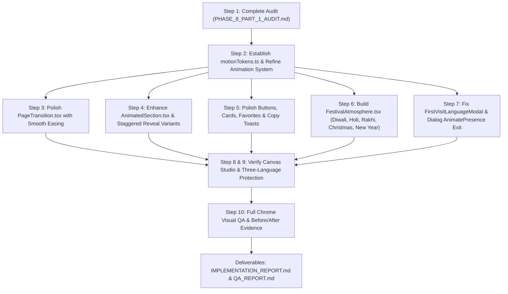

# FestiveWala — Phase 8 | Part 1: Visual Audit & Animation Polish
## Complete Codebase Inspection, Animation Inventory & Architectural Audit

---

**Project:** FestiveWala (`https://festivewala.in`)  
**Phase:** Phase 8 — Part 1 (Visual Audit & Animation Polish)  
**Date:** November 1, 2026  
**Auditor:** Antigravity Senior Frontend & Motion Graphics Engineer  
**Status:** Audit Completed & Baseline Screenshots Captured  

---

## 1. Executive Overview

This audit establishes the baseline motion and interaction characteristics of the FestiveWala codebase prior to implementing Phase 8 Part 1. FestiveWala is built on React 19, TypeScript, Vite, Tailwind CSS 3.4, and Framer Motion 14.9. 

The website already features high aesthetic standards with deep purple (`#24113D`), warm ivory (`#FAF7F0`), and metallic gold (`#D4AF37` / `#F2D98B`) palettes. However, the existing animation landscape exhibits notable inconsistencies:
- Mix of inline ad-hoc Framer Motion props and pure CSS transitions.
- Absence of a unified timing scale across interactive micro-interactions.
- Abrupt modal dismissal in `FirstVisitLanguageModal` due to misplaced `AnimatePresence`.
- Harsh CSS `animate-bounce` on copy toasts instead of refined spring/fade notifications.
- Complete absence of festival-specific atmospheric effects (subtle Diwali diya glow, Holi color splash accents, Rakhi traditional detailing, Christmas gentle snowfall, New Year celebratory sparkle).
- Missing viewport-staggered reveals on directory and inspiration pages (`FestivalsPage`, `RangoliPage`, `DecorationsPage`, etc.).
- Critical interactive workspaces (`GreetingStudio`, `PhotoStudioControls`, `CanvasPreview`) that require strict isolation from CSS transforms to avoid subpixel blur or drag offsets.

---

## 2. Components & Files Inspected

### Core Layouts & Routes
- `src/App.tsx`: App wrapper with `BrowserRouter` and `LanguageProvider`.
- `src/routes/AppRoutes.tsx`: Route definitions for 18 canonical routes.
- `src/layouts/RootLayout.tsx`: Root shell hosting Header, PageTransition, Outlet, Footer, BackToTop, and FirstVisitLanguageModal.
- `src/styles/globals.css`: Base typography, CSS custom properties, and `@media (prefers-reduced-motion)` overrides.
- `tailwind.config.js`: Color extensions, font families, shadows, and base animations.

### Animation Primitives
- `src/components/animation/motionVariants.ts`: Existing variants (`EASINGS`, `TRANSITIONS`, `pageTransitionVariants`, `fadeInUpVariants`, `cardHoverVariants`).
- `src/components/animation/AnimatedSection.tsx`: Section-level scroll reveal wrapper using `whileInView`.
- `src/components/animation/PageTransition.tsx`: Route transition wrapper.

### Major Sections & Pages
1. **Homepage & Hero:** `src/pages/HomePage.tsx`, `HeroSection.tsx`, `CountdownSection.tsx`, `FestivalDiscoverySection.tsx`, `GreetingCardShowcase.tsx`, `WishesShowcase.tsx`, `EditorialSection.tsx`, `FinalCtaSection.tsx`.
2. **Festival Experiences:** `src/pages/FestivalsPage.tsx`, `src/pages/FestivalDetailPage.tsx`, `TrilingualFAQSection.tsx`.
3. **Wishes Hub & Generator:** `src/pages/WishesPreviewPage.tsx`, `WishesShowcase.tsx`, `SmartWishesGenerator.tsx`, `WishesFavorites.tsx`.
4. **Greeting Studio & Canvas:** `src/pages/GreetingCardsPreviewPage.tsx`, `GreetingStudio.tsx`, `TemplateGallery.tsx`, `CanvasPreview.tsx`, `FormatSelector.tsx`, `TextControls.tsx`.
5. **Photo Wishes Studio:** `PhotoStudioControls.tsx`, `PhotoWishSelectorModal.tsx`, `data/photoTemplates.ts`.
6. **Inspiration Pages:** `RangoliPage.tsx`, `DecorationsPage.tsx`, `GiftIdeasPage.tsx`, `FestivalGuidesPage.tsx`.
7. **Navigation & Global Feedback:** `Navbar.tsx`, `DesktopNavigation.tsx`, `MobileNavigation.tsx`, `LanguageSwitcher.tsx`, `FirstVisitLanguageModal.tsx`, `BackToTop.tsx`, `PrimaryButton.tsx`, `SecondaryButton.tsx`.

---

## 3. Existing Animation Inventory

| Component / Feature | Current Animation Mechanism | Timing / Easing | Quality Assessment |
|---|---|---|---|
| `PageTransition.tsx` | `motion.main` with `opacity: 0->1, y: 8->0` | 350ms, `[0.22, 1, 0.36, 1]` | Acceptable entrance, but lacks exit coordination and exit transitions can cause minor layout flash |
| `AnimatedSection.tsx` | `motion.section` with `whileInView` | 500ms, `[0.22, 1, 0.36, 1]` | Works well; margin is fixed at `150px` which can delay triggers on short mobile screens |
| `HeroSection.tsx` | SVG Diya flame `y: [-3, 3, -3]` repeat | 4.5s `easeInOut` | Smooth and graceful; needs subtle flame aura pulse |
| `PrimaryButton.tsx` | `whileHover={{ y: -2 }}`, `whileTap={{ scale: 0.98 }}` | Default spring / 200ms | Good baseline; icon translation can be made more responsive |
| `SecondaryButton.tsx` | `whileHover={{ y: -2 }}`, `whileTap={{ scale: 0.98 }}` | Default spring / 200ms | Consistent with PrimaryButton |
| `DesktopNavigation.tsx` | `layoutId="activeNavIndicator"` spring | `stiffness: 380, damping: 30` | Excellent fluid indicator pill |
| `MobileNavigation.tsx` | `AnimatePresence` with `y: -16` slide | 280ms, `[0.22, 1, 0.36, 1]` | Smooth drawer opening and closing |
| `LanguageSwitcher.tsx` | Animated sliding gold background pill | 300ms CSS transition | Smooth and lightweight |
| `FirstVisitLanguageModal.tsx` | `motion.div` spring scale & y | `damping: 28, stiffness: 350` | **BUG:** Unmounts abruptly without exit animation because `if (!showLanguageModal) return null` precedes `<AnimatePresence>` |
| `WishesShowcase.tsx` Copy Toast | CSS `animate-bounce` | Infinite bounce | **POOR:** Jarring, aggressive bounce violates luxury aesthetic |
| `WishesShowcase.tsx` Favorite Button | Static SVG `<Heart>` color change | None | **MISSING:** Lacks tactile heart pop or scale spring |
| `GreetingCardShowcase.tsx` Modal | `AnimatePresence` with scale & opacity | 250ms | Good smooth dialog behavior |
| `RangoliPage.tsx` Modal | `AnimatePresence` scale & fade | 250ms | Smooth design inspection dialog |
| `FestivalsPage.tsx` Grid | Raw `motion.div whileHover={{ y: -4 }}` | 200ms | **INCONSISTENT:** No staggered entrance or viewport reveal |
| `DecorationsPage.tsx` & `GiftIdeasPage.tsx` | Static grid rendering | None | **MISSING:** Cards pop in without gentle stagger or reveal |
| Festival Pages (Diwali, Holi, Rakhi, etc.) | Static SVG motifs | None | **MISSING:** No subtle festival-specific atmospheric effects |

---

## 4. Specific Issues Identified

### Issue 1: Abrupt Modal Dismissal in `FirstVisitLanguageModal`
- **Location:** `src/components/common/FirstVisitLanguageModal.tsx` (Lines 11 & 48)
- **Problem:** The component returns `null` before `<AnimatePresence>` is reached when `showLanguageModal` flips to `false`. As a result, the exit transition (`exit={{ opacity: 0, scale: 0.94, y: 20 }}`) is skipped entirely, causing an abrupt pop-out.
- **Remediation:** Lift conditional rendering or ensure `AnimatePresence` wraps `{showLanguageModal && (...)}` properly.

### Issue 2: Jarring `animate-bounce` on Wishes Hub Copy Toast
- **Location:** `src/components/layout/WishesShowcase.tsx` (Line 304)
- **Problem:** The toast notification uses Tailwind's default `animate-bounce`, which violently jumps up and down 20 pixels continuously. This looks unpolished and distracting.
- **Remediation:** Replace with an elegant Framer Motion `AnimatePresence` floating pill that gently slides in from top (`y: -12 -> 0`), rests with a subtle gold glow, and fades out cleanly.

### Issue 3: Missing Favorite Micro-Interaction (Heart Pop)
- **Location:** `src/components/layout/WishesShowcase.tsx`, `WishesFavorites.tsx`, `RangoliPage.tsx`
- **Problem:** Clicking the favorite heart simply toggles CSS classes without any tactile response.
- **Remediation:** Implement a micro-animation with `whileTap={{ scale: 0.82 }}` and an active spring pop (`scale: [1, 1.25, 1]`) when toggled to true.

### Issue 4: Inconsistent Timing & Easing Scale
- **Location:** Various components throughout `src/`
- **Problem:** Durations vary arbitrarily between 0.15s, 0.2s, 0.25s, 0.28s, 0.35s, 0.5s, 0.6s with differing cubic beziers.
- **Remediation:** Centralize motion tokens in `motionTokens.ts` using three standard tiers:
  - Fast micro-interactions: 150ms (`luxuryEase`)
  - Standard interactions & cards: 220ms (`luxuryEase`)
  - Section & page transitions: 320ms (`luxuryEase`)

### Issue 5: Missing Festival-Specific Atmospheric Polish
- **Location:** `src/pages/FestivalDetailPage.tsx` and Festival Discovery sections
- **Problem:** The 5 core festival experiences lack subtle atmospheric lighting or motion:
  - **Diwali:** Needs a gentle golden diya halo glow with subtle shimmer.
  - **Holi:** Needs controlled subtle color accents (Gulal floating pigment particles).
  - **Raksha Bandhan:** Needs elegant traditional silk thread/motifs with gentle drape motion.
  - **Christmas:** Needs a lightweight, pure CSS snowfall with soft drifting flakes (zero heavy continuous canvas loops).
  - **New Year:** Needs subtle celebratory golden sparkles.
- **Remediation:** Create a modular, lightweight `FestivalAtmosphere.tsx` component that conditionally mounts subtle, GPU-accelerated decorative effects strictly on corresponding festival pages.

### Issue 6: Lack of Staggered Reveals on Content Grids
- **Location:** `FestivalsPage.tsx`, `RangoliPage.tsx`, `DecorationsPage.tsx`, `GiftIdeasPage.tsx`, `FestivalGuidesPage.tsx`
- **Problem:** When navigating to these pages, 12-24 large cards render instantly without staggered reveal, making the initial view feel stiff.
- **Remediation:** Implement a lightweight staggered container variant (`staggerChildren: 0.04s`, capped at 6 items to prevent layout shift) that renders smoothly when entering the viewport.

---

## 5. Protected Components (Zero-Regression Boundaries)

The following components and subsystems are strictly protected and **must never be subjected to layout transforms, CSS filters, or motion that compromises fidelity**:

1. **`CanvasPreview.tsx` & `canvasRenderer.ts`**:
   - The `<canvas>` element must NEVER receive CSS `transform: scale()` or translation while rendering or editing.
   - Preserves pixel-perfect 1080p+ geometry for exports.
2. **Greeting Studio Interactive Controls (`TextControls.tsx`, `FormatSelector.tsx`)**:
   - Live text input fields, sliders, font selectors, and color pickers must have instant, zero-latency typing response.
3. **Personal Photo Wishes Studio (`PhotoStudioControls.tsx`)**:
   - Cropping, image zoom, rotation, drag positioning, and slot assignments must remain 100% reactive without transition delays.
4. **Three-Language Context (`LanguageContext.tsx`)**:
   - Switching languages must not trigger full-page re-mounts or break animated elements.
5. **Data Stores & Schemas**:
   - Exactly 100 simple templates, 14 photo layouts, and 500 wishes must remain intact.

---

## 6. Baseline Chrome QA Screenshots Captured

The following baseline screenshots have been captured at `1440x900` and `390x844` prior to Phase 8 Part 1 implementation:

| Artifact ID | Location | Viewport | Description |
|---|---|---|---|
| `01-baseline-homepage.png` | `artifacts/qa/phase-8-part-1/baseline/` | 1440x900 | Homepage hero, countdown, and discovery sections |
| `02-baseline-festivals.png` | `artifacts/qa/phase-8-part-1/baseline/` | 1440x900 | Festivals directory with category filters |
| `03-baseline-diwali-detail.png` | `artifacts/qa/phase-8-part-1/baseline/` | 1440x900 | Diwali detail hero, traditions, and recipes |
| `04-baseline-wishes-hub.png` | `artifacts/qa/phase-8-part-1/baseline/` | 1440x900 | Wishes Hub with 500 wishes repository grid |
| `05-baseline-greeting-studio.png` | `artifacts/qa/phase-8-part-1/baseline/` | 1440x900 | Greeting Studio gallery and relationship selector |
| `06-baseline-mobile-nav.png` | `artifacts/qa/phase-8-part-1/baseline/` | 390x844 | Mobile navigation drawer open on iPhone viewport |

---

## 7. Implementation Roadmap for Phase 8 Part 1

---
*Audit completed and certified for FestiveWala Phase 8 Part 1.*

