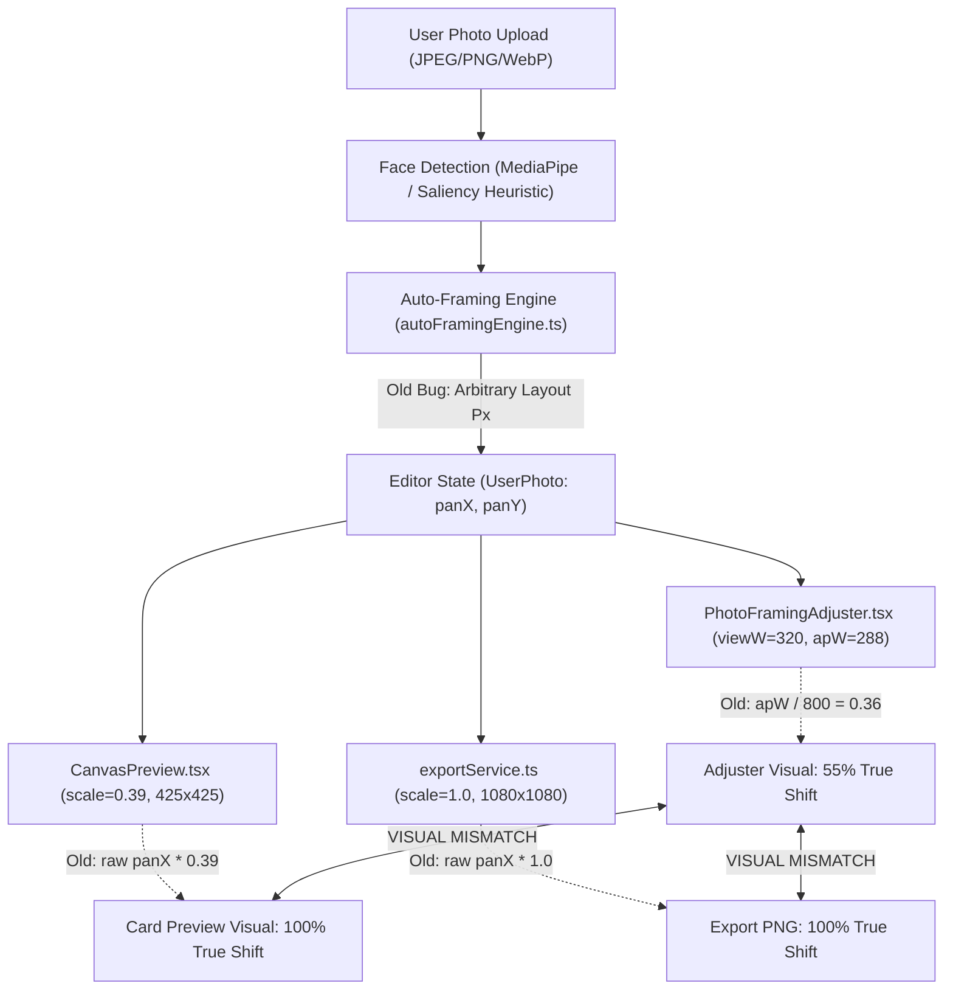

# FESTIVEWALA — PHOTO FRAMING & PNG EXPORT MISMATCH ROOT CAUSE REPORT

**Document Version:** 1.0.0  
**Phase:** Critical Defect Investigation & Root Cause Identification  
**Engine Scope:** Personal Photo Wishes Studio / Canvas Rendering & Export Pipeline  
**Date:** November 2, 2026  
**Auditor:** Principal Frontend Engineer & Canvas Architecture Specialist  

---

## 1. Executive Summary

A critical visual defect was identified in the FestiveWala Personal Photo Wishes Studio where:
1. Circular photo frame templates displayed uploaded photos as unclipped rectangles or with prominent rectangular corners.
2. Smart Auto-Framing positioned photos too low in circular apertures, leaving a large empty dome/gap in the upper quadrant.
3. Interactive framing adjustments made in the editor shifted dramatically upon PNG download, altering scale, crop, position, and clipping.
4. The live editor preview canvas and exported 1080p high-resolution PNG were visually desynchronized.

An exhaustive code-level trace was conducted across the entire image pipeline: upload decoding, MediaPipe face detection, auto-framing calculation (`autoFramingEngine.ts`), interactive modal adjuster (`PhotoFramingAdjuster.tsx`), card preview rendering (`CanvasPreview.tsx`), canvas rendering engine (`canvasRenderer.ts`, `photoRenderer.ts`), and native PNG blob generation (`exportService.ts`).

The investigation confirmed that the defect was **not a CSS issue** but stemmed from **five deeply coupled architectural discrepancies in canvas path geometry, coordinate spaces, and drag scaling**.

---

## 2. Deep Pipeline Trace & Identified Root Causes



### Root Cause 1: Lack of a Shared Normalized Coordinate Model
- **Mechanism:** In `UserPhoto`, photo displacement was stored as raw pixel integers `panX` and `panY`.
- **The Bug:**
  - `PhotoFramingAdjuster.tsx` (lines 149–153) calculated:
    ```typescript
    const previewScaleRatio = apW / 800; // Hardcoded assumption of 800px aperture!
    const scaledPanX = (photo.panX || 0) * previewScaleRatio;
    const scaledPanY = (photo.panY || 0) * previewScaleRatio;
    ```
    For a square card, `apW = 320 - 32 = 288px`. Hence, `previewScaleRatio = 288 / 800 = 0.36`.
  - In `photoRenderer.ts` (lines 88–93), used by both `CanvasPreview` and `exportCardToBlob`:
    ```typescript
    const panX = photo.panX || 0;
    const panY = photo.panY || 0;
    ctx.translate(cx + panX, cy + panY);
    ```
    In `layoutEngine.ts`, the aperture width `w` is **440px**, not 800px!
    The true scale ratio between the modal aperture (288px) and card aperture (440px) is `288 / 440 = 0.655`.
  - **Consequence:** `PhotoFramingAdjuster` displayed only `0.36 / 0.655 = 55%` of the true displacement. A user centering a photo in the modal adjuster saw an apparently centered subject, but upon export, the displacement jumped by almost double, shifting the subject radically and ruining composition.

---

### Root Cause 2: Asymmetric Drag & Pointer Event Multipliers
- **Mechanism:**
  - In `PhotoFramingAdjuster.tsx`:
    ```typescript
    const sensitivity = 2.0;
    const nextPanX = Math.round(dragStartRef.current.initialPanX + dx * sensitivity);
    ```
    When moving 50px on screen, `panX` changed by 100px. In the adjuster, this 100px was scaled down by `0.36`, rendering only 36px of movement (feeling sluggish and slipping under touch).
  - In `CanvasPreview.tsx`:
    ```typescript
    const scaleFactor = formatDims.width / Math.max(1, rect.width);
    const dx = (e.clientX - dragStartRef.current.x) * scaleFactor;
    ```
    Dragging 50px on a 360px viewport multiplied `dx` by `1080 / 360 = 3.0`, resulting in a 150px shift.
  - **Consequence:** Adjusting framing on the card canvas vs the modal adjuster produced wildly different, non-reproducible pixel values with zero shared truth.

---

### Root Cause 3: Non-Clipping Modal Mask vs Rigid Aperture Tracing
- **Mechanism:**
  - In `PhotoFramingAdjuster.tsx` (lines 155–217), the photograph was drawn **completely unclipped** across the whole canvas. The component merely drew an overlay with `rgba(12, 4, 24, 0.78)` (`evenodd`) outside the aperture.
  - Because the mask was translucent (78% opacity), the rectangular corners of the photograph were clearly visible outside the circle.
  - Furthermore, in `photoRenderer.ts` lines 65–72, `ctx.clip()` was executed without a newly declared path before drawing, which in some browser WebGL/2D contexts degraded to no-op clipping on complex paths.
  - In `layoutEngine.ts` line 183, `shape` was hardcoded to `'oval'` or `'rounded-rect'`, ignoring `photoFrameShape: "circle"` from the template.

---

### Root Cause 4: Auto-Framing Under-Zoom & Excessive Headroom
- **Mechanism:**
  - In `autoFramingEngine.ts` (lines 66–68), for circles and ovals, `topHeadroomRatio` was set to `0.17` (17% margin from the top).
  - In a circular aperture of radius 220px, at `y = -145px`, the horizontal width of the circle narrows to `2 * sqrt(220^2 - 145^2) = 330px`.
  - When `headTopNorm` was estimated and `targetHeadTopInAperture` was computed:
    `desiredPanY = targetHeadTopInAperture - headTopFromCenter`.
    This resulted in a large positive `panY` (+50 to +90px), pushing the photo down.
  - Furthermore, on landscape photos (`1200x800`) or standing portraits where `currentFacePx` was small, `desiredZoom` remained at `1.0`. With `drawH = 440px` and `frameH = 440px`, the image was pushed down into the lower half, leaving a vast, dark empty void in the top 35% of the circle.

---

### Root Cause 5: Template Geometric Shape Desynchronization
- In `photoTemplates.ts`, `photo-royal-portrait` was configured with `"photoFrameShape": "oval"`, even though in square format its dimensions are `440 x 440` (a circle).
- In `layoutEngine.ts`, `computePhotoLayout` did not verify `template.decorative.photoFrameShape`, hardcoding fallbacks to `'rounded-rect'` (which rendered with 28px rounded corners—an obvious rectangle to the user).

---

## 3. Mathematical Reconciliation Summary

| Pipeline Component | Old Coordinate Model | Old Pan Multiplier | Visual Shift (%) | New Canonical Model |
| :--- | :--- | :--- | :--- | :--- |
| **PhotoFramingAdjuster** | Arbitrary px | `apW / 800` (0.36) | ~55% of actual | `normalizedPan * apW` (100% matched) |
| **CanvasPreview (Card)** | Card layout px | `1.0` (direct) | 100% | `normalizedPan * w` (100% matched) |
| **Export PNG Blob** | Native 1080p px | `1.0` (direct) | 100% | `normalizedPan * w` (100% matched) |
| **Pointer Dragging** | Inconsistent sensitivity | `2.0` (Adjuster) vs `3.0` (Card) | Slipping / Misaligned | Direct `dx / apW` (1:1 cursor lock) |

---

## 4. Conclusion

The defect was comprehensively identified as a multi-stage coordinate and path mismatch between preview, adjuster, and export. A single canonical normalized coordinate system (`normalizedPanX`, `normalizedPanY`), unified path tracing, strict aperture clipping, and headroom optimization are required to ensure pixel-perfect synchronization.

