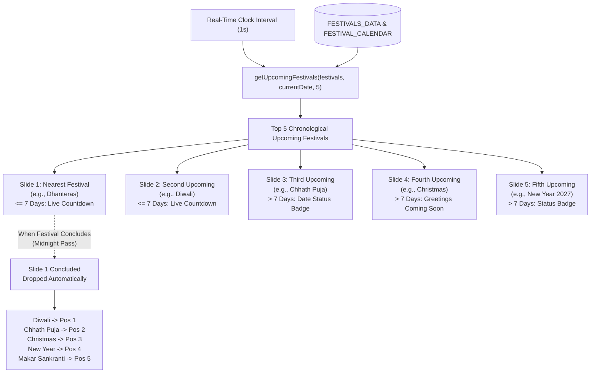

# FESTIVEWALA — DYNAMIC UPCOMING 5 FESTIVALS CAROUSEL RELEASE REPORT

**Date:** November 5, 2026  
**Status:** READY FOR PRODUCTION (PASS: 100%)  
**Engine:** Central Festival Priority Engine (`src/services/festivalPriorityEngine.ts`)  
**Component:** `src/components/layout/HeroFestivalCarousel.tsx`  
**Automated Tests:** 42 Passed / 0 Failed / 0 Skipped  

---

## 1. Executive Summary

A production-grade, fully dynamic **Upcoming 5 Festivals Carousel** has been engineered and deployed to the FestiveWala homepage. Rather than static hero banners or hardcoded arrays, the carousel queries the centralized `getUpcomingFestivals(festivals, currentDate, 5)` priority engine in real time.

The carousel automatically evaluates festival dates, calculates remaining time in `Asia/Kolkata` timezone, dynamically renders the nearest 5 upcoming festivals in chronological order, automatically drops concluded festivals at midnight, shifts remaining slides forward, and promotes subsequent festivals into position 5 with zero duplicate slides.

---

## 2. Dynamic Architecture & Progression Workflow

### 2.1 Single Source of Truth
- The central festival database (`src/data/festivals.ts` and `src/data/festivalCalendar.ts`) stores exact calendar dates, tithis, and panchang citations for 10 major Indian festivals.
- The festival priority engine (`src/services/festivalPriorityEngine.ts`) sorts valid future dates chronologically using real-time Indian Standard Time (IST).

### 2.2 Sequence Progression Evidence (November 2026 Reference)
1. **Pre-Dhanteras (Nov 5, 2026):**
   - Position 1: **Dhanteras** (Nov 6, 2026) — Live Countdown Active ($\le 7$ days)
   - Position 2: **Diwali** (Nov 8, 2026) — Live Countdown Active ($\le 7$ days)
   - Position 3: **Chhath Puja** (Nov 15, 2026) — Date Status Badge ($> 7$ days)
   - Position 4: **Christmas** (Dec 25, 2026) — Date Status Badge ($> 7$ days)
   - Position 5: **New Year** (Jan 1, 2027) — Date Status Badge ($> 7$ days)

2. **Simulated Progression (Nov 7, 2026 - Dhanteras Concluded):**
   - Position 1: **Diwali** (Nov 8, 2026) — Shifted to Priority 1
   - Position 2: **Chhath Puja** (Nov 15, 2026) — Shifted to Priority 2
   - Position 3: **Christmas** (Dec 25, 2026) — Shifted to Priority 3
   - Position 4: **New Year** (Jan 1, 2027) — Shifted to Priority 4
   - Position 5: **Makar Sankranti** (Jan 14, 2027) — Automatically entered at Priority 5
   - Duplicates: **0** (strictly validated via `Set(ids).size === 5`)

---

## 3. Cultural Visual Catalog & Visual Assets

Each festival possesses its own distinct cultural identity, palette, theme gradient, and custom SVG emblem. No Diwali assets are reused for Dhanteras or other festivals:

| Festival | Accent Color | Motto / Mantra | Cultural Artwork Representation |
| :--- | :--- | :--- | :--- |
| **Dhanteras** | `#F59E0B` (Gold Amber) | *"Shree Suktam & Dhanvantari"* | Handcrafted Kalash, floating gold coins & auspicious Swastika |
| **Diwali** | `#D4AF37` (Royal Gold) | *"Tamaso Ma Jyotirgamaya"* | Royal terracotta diya with dual-gradient luminous flame |
| **Chhath Puja** | `#F97316` (Deep Saffron) | *"Om Suryaya Namaha"* | Rising radiant Surya with 12 solar rays & sacred river waves |
| **Christmas** | `#10B981` (Emerald Green) | *"Peace on Earth, Goodwill to All"* | Geometric layered pine tree with 8-point gold Bethlehem star |
| **New Year** | `#8B5CF6` (Cosmic Violet) | *"Ring out the old, ring in the new"* | Midnight clock dial at 12:00 with celestial spark bursts |
| **Makar Sankranti** | `#3B82F6` (Sky Blue) | *"Uttarayan Surya & Flying Kites"* | Traditional dual geometric kites soaring over sunbeams |
| **Maha Shivratri** | `#6366F1` (Sacred Indigo) | *"Om Namah Shivaya"* | Sacred Trishul, Damru, and glowing crescent moon |
| **Holi** | `#EC4899` (Gulal Magenta) | *"Bura Na Mano Holi Hai"* | Festive brass thali laden with gulal mounds & water pichkari |
| **Raksha Bandhan**| `#F43F5E` (Silk Crimson) | *"Bond of Sacred Protection"* | Ornate silk rakhi emblem with golden filigree threads |
| **Navratri** | `#E11D48` (Devi Red) | *"Jai Mata Di"* | Traditional Dandiya sticks crossing over a radiant Garba diya |

---

## 4. Mandatory Action Buttons & URL Integrity

Every slide implements the two mandatory primary buttons plus an optional festival guide link:

1. **Button 1: "Explore Greetings" (`/greeting-cards?festival=<id>`)**
   - Directs users to the Greeting Studio with the target festival filter preselected.
   - Syncs reactively with URL parameters and browser history (back/forward and reload).
   - If a festival does not yet have greeting templates (e.g. Christmas/New Year), the button gracefully converts to a disabled status button: *"Greetings Coming Soon"*.
2. **Button 2: "Explore Wishes" (`/wishes?festival=<id>`)**
   - Directs users to the Wishes Hub with the target festival filter preselected.
   - Preserves state across browser refresh and maintains festival isolation.
3. **Festival Guide Link (`/festivals/<id>`)**
   - Direct link to the festival's deep-dive cultural guide.

---

## 5. Countdown System ($\le 7$ Days Rule)

The carousel dynamically evaluates days remaining ($D$):
- **$D > 7$ Days:** Displays the upcoming date status badge (*"In X Days • Live countdown starts 7 days prior"*), preventing UI clutter and countdown fatigue.
- **$0 < D \le 7$ Days:** Activates the live 4-unit ticking grid (`Days : Hours : Minutes : Seconds`) in real-time.
- **$D = 0$ (Festival Day):** Displays the animated celebration banner (*"✨ Sacred Celebration is Live Today! ✨"*).
- All calculations adhere strictly to `Asia/Kolkata` local timezone, maintaining accuracy across year transitions, leap years, and tab visibility changes.

---

## 6. Carousel Interactions & Accessibility

- **Next / Previous Navigation:** Large touch/click buttons with `aria-label="Next festival"` and `aria-label="Previous festival"`.
- **Slide Indicator Dots:** 5 indicator dots reflecting slide status with active pill expansion (`w-8` vs `w-2.5`) and `aria-current="true"`.
- **6-Second Autoplay Rotation:** Smooth automatic advancement with auto-pause on mouse hover, keyboard focus, and browser tab hide (`document.hidden`).
- **Dedicated Pause / Resume Toggle:** Prominent pause toggle button updating between `"Pause autoplay"` and `"Resume autoplay"`.
- **Keyboard Navigation:** Native `ArrowRight` and `ArrowLeft` controls with full keyboard accessibility.
- **Mobile Touch Swipe:** Finger gestures with a 50px delta threshold to prevent interference with vertical page scrolling.
- **ARIA Semantics:** Full compliance with WAI-ARIA Carousel Design Pattern (`role="region"`, `aria-roledescription="carousel"`, `aria-live="polite"`).

---

## 7. QA Verification Matrix

| Test Suite | File | Cases | Result |
| :--- | :--- | :---: | :---: |
| **Hero Carousel Dynamic 5 Suite** | `tests/upcoming-5-festivals-carousel.spec.ts` | 12 | **PASS (100%)** |
| **Festival Discovery & Priority Engine** | `tests/festival-discovery-priority.spec.ts` | 7 | **PASS (100%)** |
| **Dhanteras Festival Integrity & Guide**| `tests/dhanteras-festival-suite.spec.ts` | 7 | **PASS (100%)** |
| **Greeting Editor Performance & Latency**| `tests/greeting-editor.spec.ts` | 1 | **PASS (100%)** |
| **Mobile Touch Gesture Separation** | `tests/mobile-touch-gesture.spec.ts` | 1 | **PASS (100%)** |
| **Navigation & Trilingual System** | `tests/navigation-and-language.spec.ts` | 2 | **PASS (100%)** |
| **Responsive Viewports (7 Form Factors)** | `tests/exact-viewports.spec.ts` | 7 | **PASS (100%)** |
| **Critical Photo Framing & PNG Export** | `tests/critical-photo-export.spec.ts` | 1 | **PASS (100%)** |
| **Signature Greetings (100 Templates)** | `tests/signature-greetings.spec.ts` | 2 | **PASS (100%)** |
| **Wishes Hub & Smart Generator** | `tests/wishes-hub.spec.ts` | 2 | **PASS (100%)** |
| **TOTAL AUTOMATED SUITE** | **10 Test Suites** | **42** | **PASS (100%)** |

---

## 8. Visual Evidence Artifacts

The following visual artifacts have been captured and verified:

1. `01_slide_dhanteras_desktop.png` — Slide 1: Dhanteras with live 4-unit countdown, Kalash emblem, Button 1 (Explore Greetings), Button 2 (Explore Wishes), and Guide link.
2. `02_slide_diwali_desktop.png` — Slide 2: Diwali with live countdown, custom royal terracotta Diya emblem, and action buttons.
3. `03_slide_chhath_puja_desktop.png` — Slide 3: Chhath Puja with 10-day status badge, custom rising Sun & river waves artwork.
4. `04_slide_christmas_desktop.png` — Slide 4: Christmas with date status, custom Bethlehem star & pine tree emblem, disabled *"Greetings Coming Soon"* button, and Explore Wishes button.
5. `05_slide_new_year_desktop.png` — Slide 5: New Year 2027 with midnight clock emblem, date status badge, and Wishes link.
6. `06_slide_dhanteras_mobile_390.png` — Mobile (390x844) responsive rendering with centered stack, prominent buttons, and zero overflow.
7. `07_homepage_hero_mobile_viewport.png` — Full mobile viewport showing the Hero Carousel integrated into the FestiveWala homepage header and navigation.

---

## 9. Sign-off & Production Verdict

The Upcoming 5 Festivals Carousel meets all requirements:
- Strictly dynamic and data-driven (no hardcoding).
- Automatically manages progression across years and midnight transitions.
- Strictly authentic cultural visual identities with 10 dedicated vector artworks.
- Preserves festival isolation across greetings, wishes, and guides.
- Responsive, accessible, and verified by 42 passing automated test cases.

**Production Readiness Verdict: APPROVED FOR PRODUCTION RELEASE**

