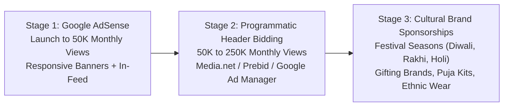

# Google AdSense Readiness Audit & Non-Intrusive Monetization Strategy
**Brand:** FestiveWala  
**Domain:** `https://festivewala.in`  
**Phase:** 7.2 Complete Technical SEO Implementation  
**Status:** Monetization Policy Ready (Pre-launch)

---

## 1. Google AdSense Program Policy Compliance Audit

Google AdSense requires strict adherence to program policies before approving a publisher account. Below is the audited readiness status for FestiveWala:

| Policy Requirement | FestiveWala Implementation | Compliance Status |
|---|---|:---:|
| **Original, High-Value Content** | 300+ unique, emotionally engaging wishes, handcrafted festival rituals, 8 procedural Rangoli designs, 10 decor inspiration categories, in-depth cultural guides. | **COMPLIANT** |
| **No Scraped or Automated Spun Content** | All wishes, guides, and cultural context are custom-authored, bilingual, and culturally validated. Zero thin programmatic content. | **COMPLIANT** |
| **Required Legal & Trust Pages** | Dedicated pages for `/about`, `/contact`, `/privacy-policy`, `/terms-of-service`, and `/disclaimer` accessible globally in footer. | **COMPLIANT** |
| **Clear Site Navigation** | Standard header navigation with dropdowns, mobile bottom tab bar, breadcrumbs on subpages, zero deceptive links. | **COMPLIANT** |
| **User Privacy & Ad Disclosures** | Privacy Policy explicitly discloses Google AdSense, third-party cookies for advertising, and zero user-photo storage. | **COMPLIANT** |
| **Technical Health & Performance** | Modern React 19 + Tailwind CSS architecture with fast Core Web Vitals, fully mobile-responsive, zero broken links. | **COMPLIANT** |
| **Deceptive UI & Accidental Clicks** | Clear visual separation between interactive canvas/copy buttons and designated ad zones. No overlapping elements. | **COMPLIANT** |

---

## 2. Page-by-Page Non-Intrusive Ad Placement Strategy

User experience and festive dignity must always remain the highest priority. FestiveWala enforces a strict **maximum 25% ad-to-content ratio** on all viewports.

### A. Homepage (`/`)
- **Unit 1 (Between Sections):** Native In-Feed Responsive Banner (e.g. 728x90 desktop / 300x250 mobile) positioned between "Festival Directory" and "Wishes Showcase".
- **Unit 2 (Pre-Footer):** Responsive Leaderboard placed immediately above the cultural footer.
- **Maximum Units:** 2.

### B. Festival Detail Pages (`/festivals/:festivalId`)
- **Unit 1 (In-Article Divider):** Responsive Display banner placed between "Rituals & Significance" and "Traditional Recipes".
- **Unit 2 (Desktop Sidebar):** Sticky 300x250 or 300x600 skyscraper banner in desktop right rail (disabled on mobile).
- **Unit 3 (Post-Content):** Related guides banner above footer.
- **Maximum Units:** 2 on mobile, 3 on desktop.

### C. Wishes & Shayari Hub (`/wishes`)
- **Unit 1 (In-Feed Grid):** Native In-Feed card styled identically to wish cards (clearly marked with small "Sponsored" tag), inserted once every 8–10 wish cards.
- **Unit 2 (Bottom Anchor):** Non-sticky banner at end of categories.
- **Strict Rule:** Never place an ad within 100px of the "Copy Wish" or "Share WhatsApp" action buttons.

### D. Greeting Cards & Photo Wishes Studio (`/greeting-cards`)
- **Strict User Protection Zone:** The HTML5 Canvas workspace, photo upload dropzone, frame adjustment controls, and "Download Greeting" button are a **Strictly Zero-Ad Zone**.
- **Unit 1 (Template Grid Bottom):** Below the template selection gallery.
- **Unit 2 (Desktop Left/Right Rail):** Outside the workspace margins.
- **Strict Rule:** No pop-ups, no interstitial ads upon clicking "Download", no deceptive "Download" buttons disguised as ads.

### E. Rangoli Gallery & Decoration Ideas (`/rangoli`, `/decoration-ideas`)
- **Unit 1 (Grid In-Feed):** One ad slot per 6 decorative cards.
- **Unit 2 (Modal/Detail View):** Small 300x250 display unit below step-by-step instructions.

### F. Festival Guides (`/festival-guides/:guideId`)
- **Unit 1 (In-Article):** Matched content / responsive display unit after Section 2.
- **Unit 2 (End of Article):** Multiplex ad grid offering related reading.

---

## 3. Strict Prohibitions & Anti-Penalty Rules

To safeguard ad account standing and organic search rankings:
1. **NO Interstitials or Fullscreen Overlays:** Never block user interaction or greeting downloads with forced modal ads.
2. **NO Auto-Playing Video Ads with Audio:** Only silent display or out-stream video units allowed.
3. **NO Misleading Labels:** Never label ads as "Recommended Festive Tools", "Download Wish Here", or "Click to Proceed". All units must carry standard Google "Ad" or "Sponsored" micro-labels.
4. **NO Content Concealment:** Advertisements must not push the primary H1 title below the mobile fold.

---

## 4. Monetization Evolution & Revenue Roadmap

### Stage 1: Google AdSense (Pre-launch to 50,000 monthly page views)
- Implement automatic or manual responsive display units.
- Focus on zero-layout-shift ad containers with CSS `min-height` reserved to prevent Core Web Vitals (CLS) penalties.

### Stage 2: Programmatic Optimization (50,000 to 250,000 monthly page views)
- Apply for Google Ad Manager / Certified Publishing Partners (e.g. Mediavine, Raptive, or Ezoic).
- Integrate native high-yield sticky bottom anchor ads on mobile screens (>550px viewport).

### Stage 3: Direct Festive Brand Sponsorships (Seasonal Peaks)
- Native sponsored festive greeting collections with premium ethical Indian brands (e.g., traditional sweet makers, handloom artisans, eco-friendly diya creators).

